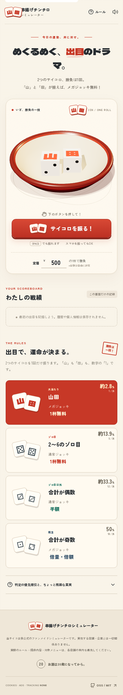

# 串揚げチンチロシミュレーター



**今日の運勢、丼に託せ。** 丼の中で3Dのサイコロが跳ねて、出目に応じたジョッキの会計を表示する、非公式の運試しWebアプリです。

## 遊び方

1. 定価を入力します（初期値は500円、任意の金額に変更できます）。
2. **「サイコロを振る！」** をタップします。パソコンなら `Space` キーでも振れます。
3. 振れるのは1回勝負。結果と、設定した定価に対する支払額を表示します。
4. 「もう一度、勝負！」で何度でも遊べます。回数と支払額の合計は戦績に記録されます。

対応する端末では、端末を振ってもサイコロを振れます。ブラウザが動作センサーへのアクセスを許可している場合に限ります。

## ルールと確率

サイコロは2個です。1個目の「山」、2個目の「田」は、それぞれ数字の **1** です。以下の順に判定します。

| 出目 | 結果 | 組み合わせ数 | 確率 |
| --- | --- | ---: | ---: |
| 山 + 田（1のゾロ目） | メガジョッキ1杯無料 | 1 / 36 | 約2.8% |
| 2〜6のゾロ目 | 通常ジョッキ1杯無料 | 5 / 36 | 約13.9% |
| ゾロ目以外で、合計が偶数 | 通常ジョッキ半額 | 12 / 36 | 約33.3% |
| 合計が奇数 | メガジョッキ倍量・倍額 | 18 / 36 | 50% |

山・田が1つだけ出たときは「1」として合計します。

支払額を `P` とすると、1回の支払額の期待値は次のとおりです。

```text
P × (0 × 1/36 + 0 × 5/36 + 1/2 × 12/36 + 2 × 18/36) = P × 7/6 ≈ P × 1.1667
```

つまり、**支払額の期待値は定価の約1.17倍**です。あくまで確率のお遊びとしてお楽しみください。

## 演出

- [Three.js](https://threejs.org/) と [cannon-es](https://pmneila.github.io/cannon-es/) による3Dの落下・回転・反跳
- 最後に上を向く面を、ゲームの出目にそろえて収束
- 山田では紙吹雪・画面震動・フォーファンファーレ・泡立つジョッキ
- ゾロ目、半額、倍量倍額に、それぞれ別の色と効果音
- 効果音は [Web Audio API](https://developer.mozilla.org/ja/docs/Web/API/Web_Audio_API) で端末内合成。ミュート切り替えつき
- `prefers-reduced-motion` に対応し、視差・紙吹雪・長い回転を軽減

物理演算の途中経過は演出で、確率には影響しません。出目は暗号学的乱数 `crypto.getRandomValues` から、剰余バイアスを避ける棄却サンプリングで決めています。

## プライバシーと免責

- 広告、Cookie、バックエンドはありません。アクセス数は Cookie を使わない匿名の集計で見ます。個人を特定する情報は集めません。
- 定価や戦績はブラウザ上のメモリにのみ保持され、ページを再読み込みするとリセットされます。ローカルストレージも使いません。
- **非公式のファンメイドシミュレーターで、実在する店舗・企業とは一切関係ありません。** 実際のルール・提供内容・対象メニューは各店舗の案内を優先してください。
- 実店舗の名称、ロゴ、写真は使用していません。
- **お酒は20歳になってから。** 飲酒運転は法律で禁止されています。

## 技術スタック・開発

Vite + React + TypeScript + Tailwind CSS。静的サイトとしてビルドされます。日本語フォントは同梱しています。

```sh
npm install
npm run dev
```

### 検証

```sh
npm run test       # 判定と全36通りの確率、会計・集計の単体テスト
npm run test:e2e   # Playwright: 4結果、連続操作、スマホ、アクセシビリティ
npx playwright install chromium # 初回のみ（npm install後、テスト前に実行）
```

E2EはモバイルとデスクトップのChromiumで実行します。`@axe-core/playwright` によるWCAG 2 A / AAとWCAG 2.1 AAの自動検査も含みます。

開発サーバーからのみ、`?force=yamada`、`?force=free`、`?force=half`、`?force=double` で出目を指定できます。本番ビルドでは無効です。

```sh
npm run build
npm run preview
```

`dist/` を任意の静的ホスティングへ公開できます。`vercel.json` にはVite向けのビルド設定があります。

## ライセンス・クレジット

コードは [MIT License](LICENSE) です。

- Three.js: MIT License / Copyright © three.js authors
- cannon-es: MIT License / Copyright © Stefan Hedman
- Icons: Lucide, ISC License
- 本文フォント: Zen Kaku Gothic New（派生フォント名: Zen Kaku Gothic New Local）, SIL Open Font License 1.1
- 表示フォント: Dela Gothic One, SIL Open Font License 1.1。必要文字のみのサブセットを、Dela Gothic Local（Dela Gothic One派生）として同梱
- 効果音・3Dモデル・紙吹雪・ジョッキはこのプロジェクト内で生成しており、外部素材はありません。

フォントのライセンスは `THIRD_PARTY_NOTICES.md` にまとめています。
